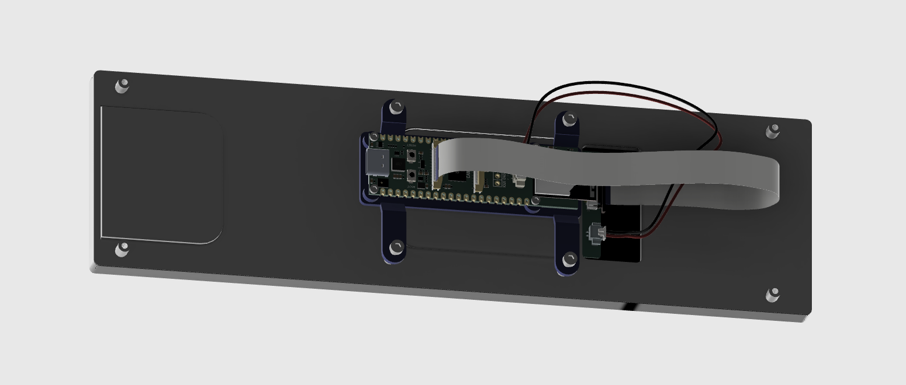
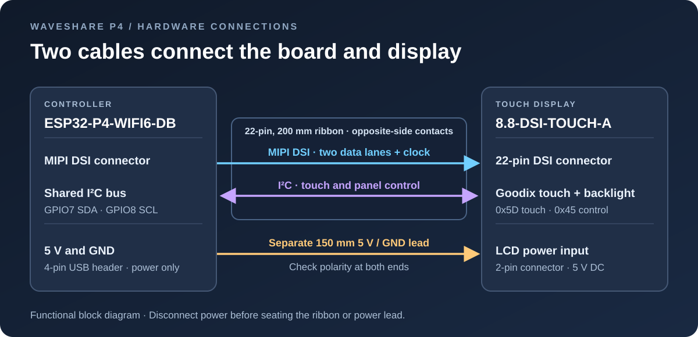
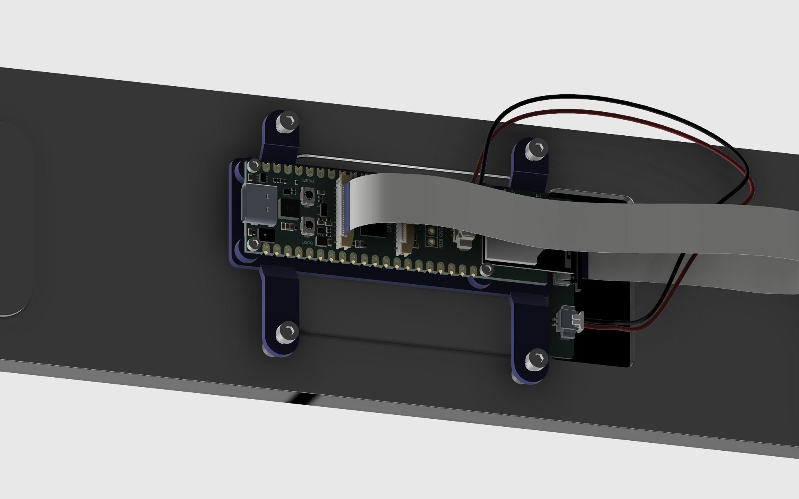

# Waveshare 8.8″ MIPI DSI display with ESP32-P4

Build a slim touchscreen using the Waveshare **ESP32-P4-WIFI6-DB**, the **8.8-DSI-TOUCH-A** LCD, and a 3D printed bracket that mounts the controller behind the display. A ribbon carries the picture and touch/control signals; a separate lead powers the LCD. The ESPHome bring-up configuration displays a landscape LVGL colour pattern and an interactive touch-test button.

**8.8″ IPS touchscreen · 480 × 1920 native · 1920 × 480 landscape · Two-lane MIPI DSI**

[Parts](#1-bill-of-materials) · [Wiring](#2-connect-the-display) · [Mechanical build](#3-print-and-assemble) · [ESPHome](#4-load-esphome) · [Screen photos](#5-screen-photos)

## 1. Bill of materials

| Qty | Part | Specification |
| :---: | --- | --- |
| 1 | Controller | [Waveshare ESP32-P4-WIFI6-DB](https://docs.waveshare.com/ESP32-P4-WIFI6-DB), with onboard ESP32-C5. |
| 1 | LCD | [Waveshare 8.8-DSI-TOUCH-A](https://www.waveshare.com/product/displays/8.8-dsi-touch-a.htm), SKU 33641, with OTA7290B display controller and GT9271 touch. |
| 1 | DSI ribbon | 22 contacts, approximately 200 mm, contacts on opposite sides. Supplied with the LCD. |
| 1 | LCD power lead | Approximately 150 mm, MX1.25 4-pin board end to MX1.25 2-pin LCD end. Use 5 V and ground only. Check the supplied lead against the board and panel labels. |
| 1 | USB-C data cable and suitable 5 V supply | For flashing and power. Allow headroom for both the controller and the LCD; Waveshare specifies at least 0.43 A for the LCD alone. |
| 1 | Insulating bracket | Print the [STL](hardware/p4-lcd-bracket.stl) in unfilled PETG. [STEP](hardware/p4-lcd-bracket.step) is also provided. |
| 4 | PCB screws | M1.6 × 5 mm, with approximately 2.9 mm diameter heads as modeled. |
| 4 | LCD mounting screws | M2.5 socket head. Fusion shows 8 mm length; select the actual length by checking usable standoff depth and tab thickness. |

## 2. Connect the display

1. Disconnect USB-C power. Connect the board's **DSI** socket to the LCD's **DSI** socket with the supplied 22-pin ribbon. The nearby **CSI** socket is for a camera. Open each latch, align the exposed ribbon contacts with the socket contacts, insert squarely, and close the latch.
2. Connect the LCD's separate **5 V and GND** input. In this build the lead takes power from the P4 board's 4-pin USB header; the two USB data pins are unused. Verify 5 V and ground at both ends before powering the board. Use the [board documentation](https://docs.waveshare.com/ESP32-P4-WIFI6-DB) and [LCD interface guide](https://www.waveshare.com/wiki/8.8-DSI-TOUCH-A#Interfaces) for connector identification.
3. After checking the ribbon and power polarity, power the board through USB-C. On first boot, the I²C scan helps confirm that the backlight controller and touchscreen are reachable.

| Connection | What it does |
| --- | --- |
| Two-lane MIPI DSI | Carries the pixel stream and display commands to the OTA7290B. |
| I²C over the same ribbon | GPIO7 SDA and GPIO8 SCL. Goodix touch at `0x5D` on this build; LCD control at `0x45`, with brightness at register `0x96`. |
| Separate 5 V and GND lead | Powers the LCD. Route it with slack and keep it clear of the mounting tabs. |

## 3. Print and assemble

The Fusion design **Waveshare P4 bracket v11** places the ESP32-P4 behind the panel, using the LCD's four central standoffs. The mount provides a through relief for the speaker connector, a shallow microSD pocket and four blind PCB screw holes.

[**Print and assembly instructions →**](hardware/README.md) · [STL](hardware/p4-lcd-bracket.stl) · [STEP](hardware/p4-lcd-bracket.step)

## 4. Load ESPHome

Start with [p4-88-bringup.yaml](firmware/p4-88-bringup.yaml), which draws an LVGL colour pattern and tests touch. The [MIPI DSI component source](firmware/waveshare_pr_components/mipi_dsi) is included beside the YAML. The [firmware guide](firmware/README.md) covers flashing, first boot checks, and the required source files.

The bring-up YAML contains the panel startup sequence, backlight control, landscape rotation, seven colour bars and a button that displays **Touch OK** when tapped. It uses LVGL's built-in font.

**First boot checks:** If the backlight is dark, check 5 V/GND and whether `0x45` responds. If the backlight is on but there is no picture, check the DSI latch and confirm the firmware is using the supplied 8.8-inch model. If the picture works but touch does not, check the I²C scan and the Goodix address before changing rotation.

### Why the custom component is included

The custom component backports support for the 8.8-inch OTA7290B panel to ESPHome 2026.9.0. It supplies the panel’s timings and initialization commands, honours its requirement to skip software reset, and retains the D-PHY clock fix used by the production ESP32-P4 board. The project’s hardware testing found that issuing software reset left the backlight on without a picture. Keep the included component beside the YAML so ESPHome loads this tested driver.

## 5. Screen photos

Photos of the running display will be added here. The images above are Fusion renders of the mechanical assembly.

Hardware references: [Waveshare board documentation](https://docs.waveshare.com/ESP32-P4-WIFI6-DB) · [Waveshare display wiki](https://www.waveshare.com/wiki/8.8-DSI-TOUCH-A) · [ESPHome MIPI DSI documentation](https://esphome.io/components/display/mipi_dsi/)
