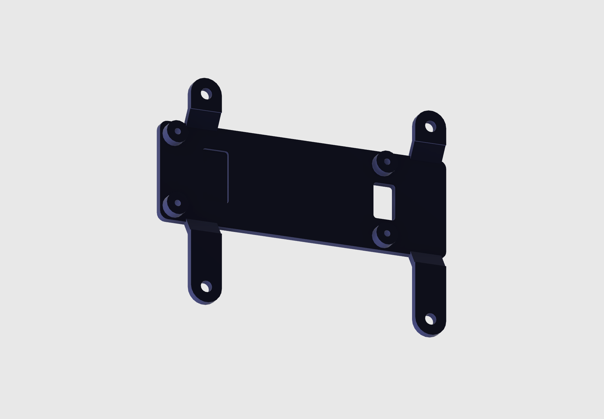

# Print and mount the bracket

The bracket mounts the ESP32-P4 behind the LCD using its four central standoffs. The parts here are exported from **Waveshare P4 bracket v11**.

- [STL for printing](p4-lcd-bracket.stl) · [STEP for CAD](p4-lcd-bracket.step)
- [Back to the build guide](../README.md#3-print-and-assemble)

1. Print in unfilled PETG with the LCD-facing central surface down. Start with 0.2 mm layers, three perimeters, and solid infill. Support the raised tabs.
2. Dry-fit the PCB and check that the speaker connector and microSD socket clear their reliefs.
3. Fit four M1.6 × 5 mm screws from the component side. Tighten gently into the blind holes. Check that the heads clear nearby components and that the insulating floor stays intact.
4. Fit the four outer tabs to the LCD standoffs. The CAD uses M2.5 × 8 mm screws. Check each standoff’s usable thread depth and tab thickness so the screws do not bottom out.
5. Connect both cables with power removed and check that the ribbon has a smooth bend and cannot get trapped.
